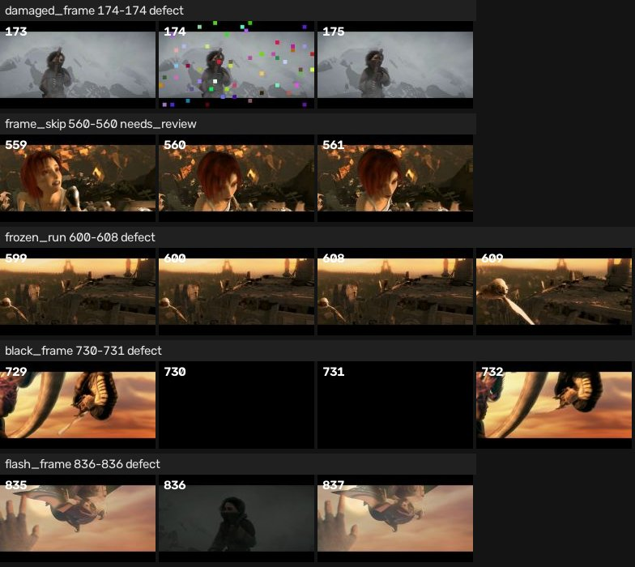
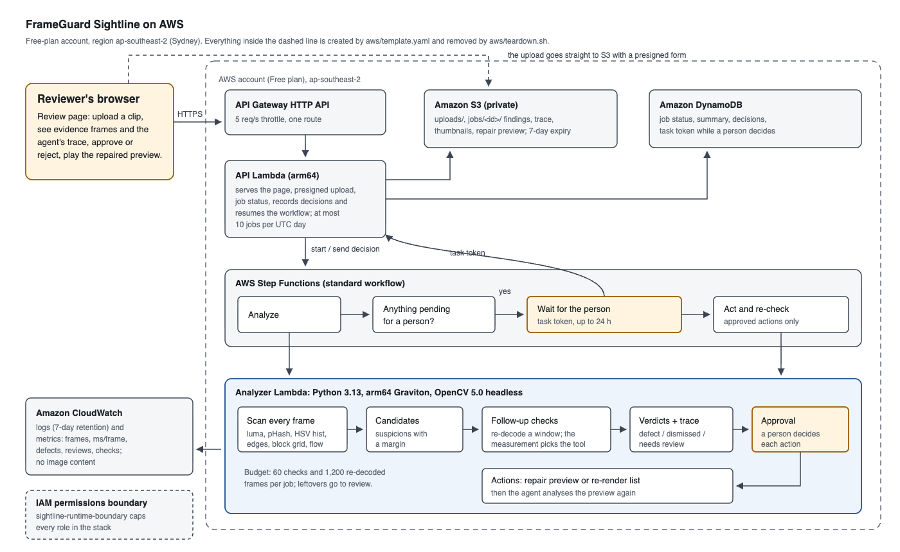

# 1. Problem and users

Exported video still reaches clients with black frames from a timeline gap, a stalled render,
one stray frame from another shot, block-damaged frames from a bad encode, or dropped frames.
These faults last a fraction of a second, so a tired reviewer misses them and a second pass costs
another full viewing. Small studios, animation teams, independent producers and education or
nonprofit media labs rarely have a dedicated quality-control operator.

Sightline gives them a first pass that can be checked instead of trusted blindly. It says which
frames are wrong, shows the frames before and after, explains the measurement behind each call,
and leaves every change to a person.

# 2. What the system does

A job has six stages.

1. **Scan.** Each frame is decoded once and measured at 320 px width.
2. **Suspect.** Detectors turn the measurement series into candidate events with a margin.
3. **Check.** An agent chooses a follow-up check for each candidate, re-decodes only the window it
   needs, and measures again. The result decides the next step: confirm, dismiss with a reason,
   fold a matching event into the same finding, or ask a person.
4. **Decide.** Findings end as `defect`, `dismissed` (intended material such as a fade, an edit, a
   held title or slow motion) or `needs_review`.
5. **Act.** After a person approves, black, flash and damaged frames are patched in a preview by
   holding the nearest good frame of the same shot; stalls and skips go to a re-render list.
6. **Re-check.** The agent analyses the repaired preview and reports whether each repaired range is
   clean. In the demo job on AWS (a held-out test clip: the Sintel trailer with five seeded defects)
   the agent reported four defects and one item for review. The reviewer approved all five: the
   damaged, black and flash frames were repaired in the preview, the stall and the frame skip went to
   the re-render list, and the re-check found every repaired range clean.



# 3. OpenCV 5 implementation

All analysis uses OpenCV 5.0.0 (`opencv-python-headless` 5.0.0.93) with NumPy.

| Purpose | OpenCV 5 calls |
|---|---|
| Bounded decoding | `VideoCapture` (frame count, size and fps checked before decoding), `imread`, `resize` with `INTER_AREA` |
| Exposure and emptiness | `cvtColor`, `meanStdDev`, `calcHist` (luma entropy) |
| Shot identity | 64-bit perceptual hash from `dct` of a 32x32 frame; HSV `calcHist` + `normalize` compared with `compareHist(HISTCMP_BHATTACHARYYA)` |
| Layout change | `Canny` edge density |
| Block damage | 8x8 block-grid step and ratio; 16x16 temporal outlier blocks from `absdiff` against clean neighbours |
| Motion | `calcOpticalFlowFarneback`, `magnitude`; changed-pixel fraction from `absdiff` |
| Evidence and actions | `imwrite` thumbnails and contact sheet, `VideoWriter` (H.264 `avc1`, falling back to VP8 and MPEG-4) for the repair preview |

Two measurement problems found on real footage shaped the design.

* **Farneback is unstable on flat or saturated regions.** On two pixel-identical frames of the Sintel
  trailer, about 1% of vectors reported displacements up to 540 px and the mean magnitude was
  1.2-1.7 px. Statistics therefore drop the largest 2% of vectors, and stalls are decided from the
  fraction of changed pixels, not from flow.
* **The block ratio explodes on flat frames.** Black, white and plain title frames have almost no
  texture inside blocks, so faint compression steps produce ratios of 6-32. A damage candidate now
  also needs a large absolute step on the block grid, and the follow-up check looks for 16x16 blocks
  that change in the suspect frame only, while the frames around it agree.

# 4. The agent loop

The agent is a bounded controller, not a language model. It owns five tools, one per candidate
kind, and a budget of 60 checks and 1,200 re-decoded frames per job. Each tool returns
measurements, and the measurements choose the verdict or the next action:

* A shot change whose picture returns to the previous shot within two frames, in both colour and
  layout, becomes a flash; the cut back is removed from the queue so one fault yields one finding.
  Colour alone is not enough: consecutive title cards share a palette but not a layout.
* A dark run is compared across its two sides. The same shot on both sides is a defect, a gradual
  luma decline is a fade, a held black between different shots is a cut to black, and a short black
  between different shots goes to a person because it may be a timeline gap.
* A still run is a stall only if its pixels are identical at full resolution, it does not start at
  an edit, and the same shot resumes and moves around it.
* A motion jump next to a confirmed stall or damaged frame is explained by that neighbour and
  dismissed; otherwise its whole-frame (median) motion and direction are compared with the shot's.
* Damage is checked against the nearest neighbours that no other candidate covers, so a stall
  next to a damaged frame cannot serve as its reference.

Every check is written to a trace with the measurement that triggered it, the numbers it produced
and its decision. The review page shows the trace under each finding. Nothing is changed before a
person approves, and the change is verified by analysing the result again.

# 5. AWS deployment

The stack is one CloudFormation template (`aws/template.yaml`), deployed on 2026-10-15 into a
free-plan account in ap-southeast-2 (Sydney), the region the account allows for regional services.



* **Amazon S3** holds uploads and reports in a private, encrypted bucket. Browsers upload through a
  presigned form limited to 80 MB; media are served with 15-minute presigned links; everything
  expires after 7 days.
* **AWS Step Functions** runs analyze, then a wait-for-person step that holds a task token for up to
  24 hours, then act and re-check. The workflow resumes only when a person sends decisions.
* **AWS Lambda on Graviton (arm64)** runs OpenCV 5 with 2 GB of memory; a second small Lambda serves
  the review page and the JSON API. The Linux OpenCV wheel has no H.264 encoder, so the repair preview
  is written as VP8 WebM there (H.264 MP4 on macOS).
* **Amazon DynamoDB** keeps job state and decisions; the task token never leaves the backend.
* **Amazon API Gateway** (HTTP API) is throttled to 5 requests per second.
* **Amazon CloudWatch** keeps 7 days of logs and Embedded Metric Format metrics (frames, ms per frame,
  defects, reviews, checks). Logs contain numbers only, never image content.

Each role has only the actions it needs on its own bucket, table and state machine, and every role
carries the `sightline-runtime-boundary` permissions boundary. The user that deploys the stack can
create roles only with that boundary attached and cannot remove it, so no role can grow beyond the
job's own resources. The public page accepts at most 10 jobs per UTC day, which bounds how many
analyses it can start; requests and downloads are limited only by the API throttle and the 7-day
expiry.

# 6. Evaluation

Thresholds were developed on synthetic seeds 101-124 and real seeds 201-203 and 301-303, then frozen.
The test sets below were generated afterwards and scored once. A labelled defect counts as found when
a `defect` or `needs_review` finding of the same kind overlaps it; every other flagged finding is a
false positive.

**Synthetic test set.** 24 clips, 5,349 frames, 640x360. Each clip mixes material that must not be
flagged (intended cuts, a held title card, slow motion, a fade to black) with 3-5 injected defects.

| Defect | Labels | Found | Confirmed as defect | False positives |
|---|---|---|---|---|
| Black frame | 20 | 20 | 20 | 0 |
| Frozen run | 19 | 19 | 19 | 0 |
| Flash frame | 15 | 15 | 15 | 0 |
| Damaged frame | 20 | 19 | 19 | 0 |
| Frame skip | 19 | 15 | 12 | 0 |

**Real footage test set.** Defects seeded into the Sintel and Big Buck Bunny trailers (Blender
Foundation, CC BY 3.0), placed inside moving shots and re-encoded as 640 px MP4. 6 clips, 6,184 frames.

| Defect | Labels | Found | Confirmed as defect | False positives |
|---|---|---|---|---|
| Black frame | 5 | 5 | 5 | 4 |
| Frozen run | 3 | 2 | 2 | 0 |
| Flash frame | 4 | 3 | 3 | 0 |
| Damaged frame | 3 | 3 | 3 | 0 |
| Frame skip | 3 | 1 | 0 | 2 |

False positives were 0.0 per 1,000 frames on the synthetic set and 0.97 on the real set. Three of the
four black-frame false positives are one natural two-frame black between two shots of Big Buck Bunny
that the agent sends to review; the fourth is a seeded flash whose inserted picture was dark.

**Clean footage.** The unmodified 1080p trailers (2,065 frames) produce no `defect` finding and one
item for review.

**Cost.** The first pass took 6.3 ms per frame on the real set and 9.2 ms on the synthetic PNG set
(Apple M4, one process); follow-up checks re-decoded 55-184 frames per clip. Peak memory tracked by
Python's `tracemalloc` stayed under 60 MB per job (OpenCV's native buffers are not included). On AWS
Lambda (arm64, 2 GB) the demo job's first pass took 18.3 ms per frame; upload to the decision step
took 33 s and the actions with their re-check 59 s. That job's findings matched the local run, with
two more events dismissed and two more follow-up checks, which we attribute to the different FFmpeg
build decoding the clip.

# 7. Limitations

* Frame skips are the weakest class on real footage. They are judged on whole-frame motion so that a
  fast local subject (a dragon's wings) is not called a skip, which also misses skips in fast camera
  moves; two false alarms remain in one dragon shot.
* A flash whose inserted picture is dark is reported as a black frame: the right frames, the wrong
  name.
* Repairs hold a neighbouring frame. They confirm the diagnosis and give a usable preview, but a
  re-render from the source project is the real fix.
* Seeded real-footage tests use two trailers; broader footage (grain, interlacing, HDR, very long
  takes) is not yet measured.

# 8. Responsible use

Sightline inspects picture integrity only. It does not detect or identify people. Dismissed items
stay visible with their reasons so a person can overrule the agent, and no footage is changed without
an approval recorded with its author and time. Uploads expire after 7 days and logs hold numbers
only.

# 9. Reproducing the results

```sh
.venv/bin/python -m pytest
.venv/bin/python -m sightline.cli synth data/synthetic-test --seeds 1001-1024
.venv/bin/python -m sightline.cli evaluate data/synthetic-test --out results/eval_synthetic_test.json
# IAM policies for the deploying user, then the stack (deploy.sh runs aws/preflight.py first)
python aws/iam/render.py --account <id> --region <region>
AWS_REGION=<region> aws/deploy.sh
```
